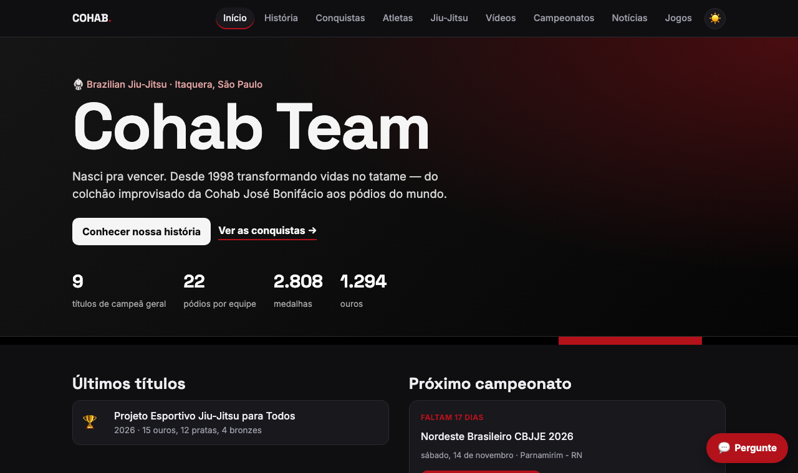

<p align="center">
  
</p>

<p align="center">
  <a href="https://yagoxavier10.github.io/cohab-team/"></a>
  <a href="https://github.com/YagoXavier10/cohab-team/actions/workflows/update-news.yml"></a>
  <a href="https://github.com/YagoXavier10/cohab-team/actions/workflows/update-cohab.yml"></a>
</p>

<p align="center">
  
  
  
  
  
  
</p>

Site da Cohab Team, equipe de jiu-jitsu de Itaquera (São Paulo), desde 1998.

## 📸 Prévia

<p align="center">
  <a href="https://yagoxavier10.github.io/cohab-team/"></a>
</p>

## 🗂️ Páginas

🌐 https://yagoxavier10.github.io/cohab-team/

- `index.html` — página inicial: números, últimos títulos, próximo campeonato e notícias
- `historia.html` — história, mestres, linhagem e linha do tempo
- `conquistas.html` — títulos, pódios e medalhas em todas as federações
- `atletas.html` — busca de atletas (nomes de crianças abreviados)
- `campeonatos.html` — próximos campeonatos da CBJJE e calendários das federações
- `noticias.html` — notícias de jiu-jitsu, buscar e salvar para ler depois
- `quiz.html` — quiz da Cohab

## 🤖 Automação

- `.github/workflows/update-news.yml` — todo dia às 07:00: notícias (`scripts/fetch_news.py`) e campeonatos (`scripts/fetch_campeonatos.py`)
- `.github/workflows/update-cohab.yml` — toda segunda às 06:00: conquistas (`scripts/update_cohab.py`), com dados brutos em `data/cohab/`

## 💻 Rodar localmente

```bash
python -m http.server 8000   # abra http://localhost:8000
```

Feito por [Yago dos Santos](https://yagoxavier10.github.io/portfolio-noticias/).

## 📄 Licença

Distribuído sob a licença MIT. Veja o arquivo [LICENSE](LICENSE).
